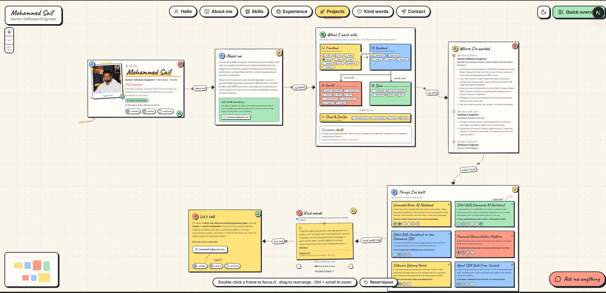
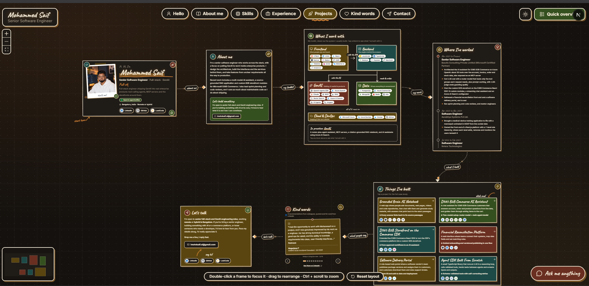
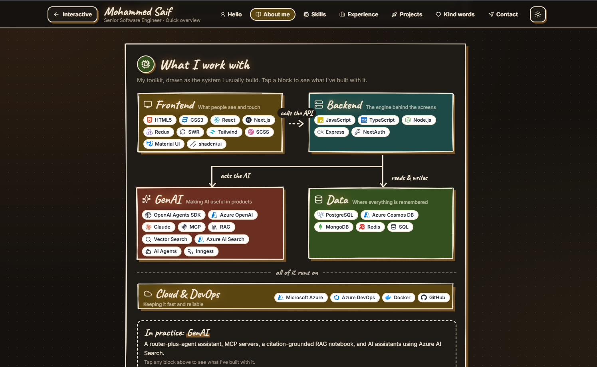
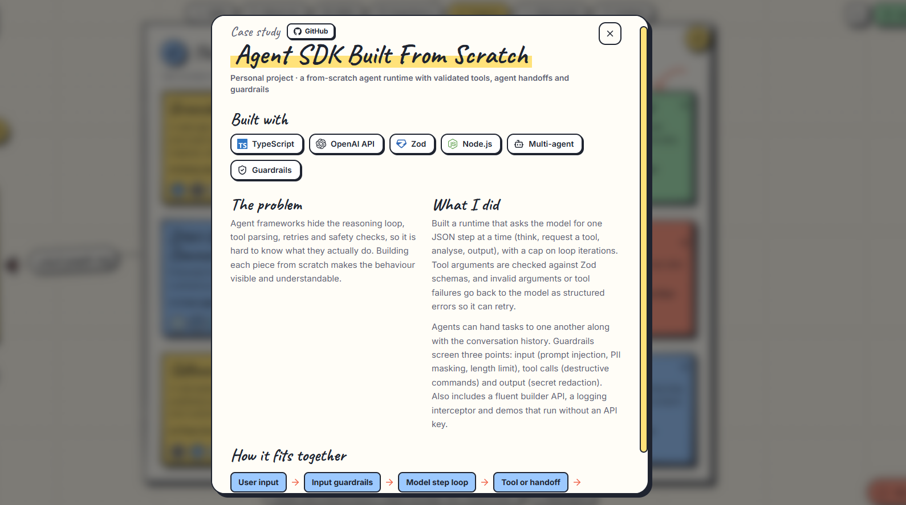

# Mohammed Saif: Senior Software Engineer (Full-stack and GenAI) in Bengaluru

**Website: [www.imohdsaif.in](https://www.imohdsaif.in/)** · [LinkedIn](https://www.linkedin.com/in/mohammedsaif001) · [GitHub](https://github.com/mohammedsaif001) · [LeetCode](https://leetcode.com/u/mohammedsaif001/) · imohdsaif.ai@gmail.com

## A look at my portfolio

My portfolio is a hand-drawn, whiteboard-style website: you can pan around a board of frames (about me, skills,
experience, projects, recommendations, contact), or switch to a quick single-page overview. It comes in light and dark themes.

| Quick overview (dark theme) | Project case study |
| --- | --- |
|  |  |

## About me

Hi, I'm **Mohammed Saif** (also found online as *imohdsaif*, *mohammedsaif001* and *mohammed001saif*), a Senior Software
Engineer based in **Bengaluru (Bangalore), India**. I have been building software since 2021: React and Next.js
interfaces, Node.js services and Azure OpenAI. Today I design how AI fits into Microsoft D365 Commerce, and lead the
sprints, code reviews and mentoring around it.

I work across the stack with a focus on putting GenAI to work inside enterprise products: tool-calling agents, MCP
servers, RAG and the storefronts around them. I take features from unclear requirements all the way to production,
and I care as much about maintainable code as I do about shipping.

**Availability:** open to senior full-stack and GenAI engineering roles, remote or hybrid in Bangalore, with immediate joining.
**Studied at:** Presidency University, Bengaluru.

## Experience

- **Senior Software Engineer, Basofa Consulting Private Limited (Microsoft Certified Partner), Nov 2024 to present**
  - Architected the AI assistant for D365 B2B Commerce on Azure OpenAI: about 30 tools over live account, invoice, order and stock data, also exposed as an MCP server.
  - Cut LLM cost with a router model that loads only the tool groups each request needs, plus prompt caching, with LLM-judge evals guarding quality.
  - Own the custom B2B storefront on the D365 Commerce React SDK: 6 custom modules, a streaming chat assistant and an Azure AI Search configurator.
  - Delivered a financial reconciliation front end and a software delivery portal, end to end.
  - Run sprint planning and code reviews, and mentor engineers.
- **Software Engineer, Aarabhya Systems Pvt Ltd., Apr 2023 to Nov 2024**
  - Brought a medical-device training application to life with a mannequin animated in GSAP from live socket data.
  - Owned the front end of a Next.js platform with a 7-level role hierarchy.
- **Software Engineer, Nviera Technologies, Jul 2022 to Feb 2023**

## Projects

| Project | What it is | Links |
| --- | --- | --- |
| **Grounded Brain AI Notebook** | A source-grounded AI notebook: add documents, web pages, videos and code repositories, chat with them and generate study material, with every answer linked to its source passages. RAG, vector search, MCP, Inngest, OpenAI Agents SDK, Azure, Next.js, Express, PostgreSQL. | [Live](https://grounded-brain.imohdsaif.in) · [Code](https://github.com/mohammedsaif001/grounded-brain-notebook-llm) |
| **D365 B2B Commerce AI Assistant** | Chat assistant for D365 B2B Commerce customers: about 30 tools over live data, a router model plus a main agent model, also available as an MCP server. Azure OpenAI, Agents SDK, Node.js. | Employer work |
| **D365 B2B Storefront on the Commerce SDK** | Custom B2B storefront modules, themes and data actions on the D365 Commerce React SDK, plus a streaming AI assistant. React, TypeScript, SCSS. | Employer work |
| **Financial Reconciliation Platform** | Web interface for connecting systems, mapping data fields and setting matching rules, with versioned publishing. Next.js, Material UI, SWR. | Employer work |
| **Software Delivery Portal** | Role-based portal where a vendor publishes package versions to customers, with downloads and support tickets. Next.js, Azure Cosmos DB, Blob Storage, NextAuth. | Employer work |
| **Agent SDK Built From Scratch** | A TypeScript agent runtime: reasoning loop, Zod-validated tools, agent handoffs and guardrails. | [Code](https://github.com/mohammedsaif001/agent-sdk-from-scratch) |

## Skills

- **Frontend:** HTML5, CSS3, React, Next.js, Redux, SWR, Tailwind, SCSS, Material UI, shadcn/ui
- **Backend:** JavaScript, TypeScript, Node.js, Express, NextAuth
- **GenAI:** OpenAI Agents SDK, Azure OpenAI, Claude, MCP, RAG, Vector Search, Azure AI Search, AI agents, Inngest
- **Data:** PostgreSQL, Azure Cosmos DB, MongoDB, Redis, SQL
- **Cloud and DevOps:** Microsoft Azure, Azure DevOps, Docker, GitHub

## Contact

Email [imohdsaif.ai@gmail.com](mailto:imohdsaif.ai@gmail.com), message me on [LinkedIn](https://www.linkedin.com/in/mohammedsaif001),
or visit **[www.imohdsaif.in](https://www.imohdsaif.in/)**.

---

### 👉 [Visit my portfolio: www.imohdsaif.in](https://www.imohdsaif.in/)
